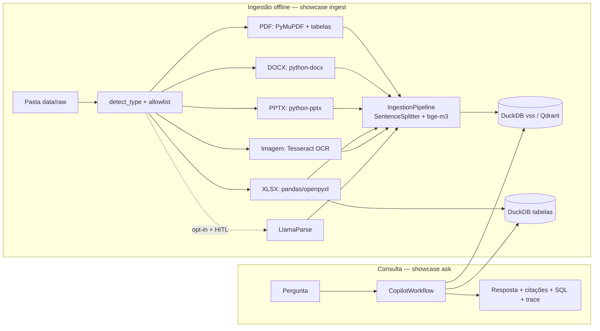
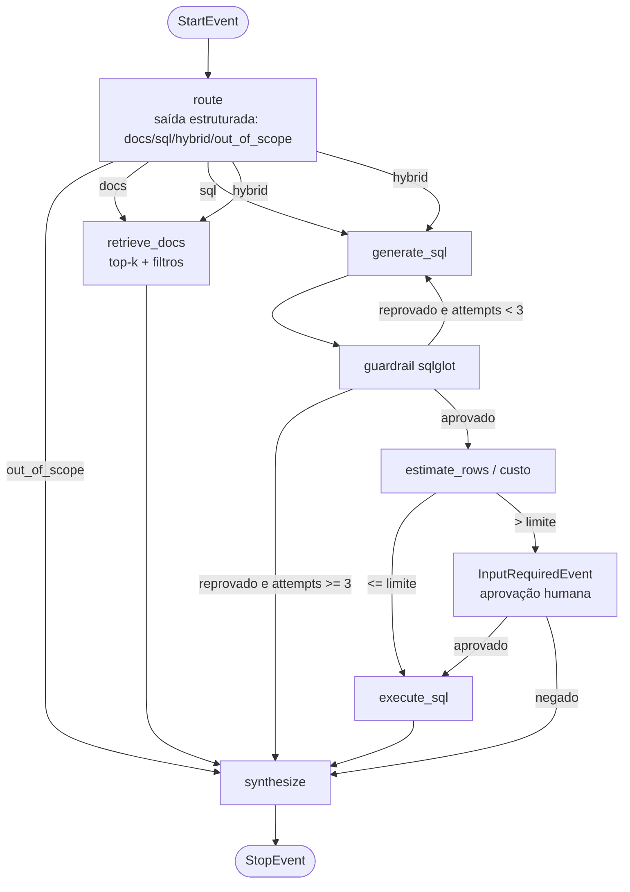

# System Design — Copilot RAG multimodal + NL→SQL em LlamaIndex

| Campo | Valor |
|-------|-------|
| **Status** | Proposto (2026-10-16) |
| **PRD** | `prd-copilot-rag-multimodal-llamaindex.md` |
| **ADRs** | ADR-001 (LlamaIndex Workflows), ADR-002 (dados públicos), ADR-003 (LLM/SLM), ADR-004 (ingestão), ADR-005 (embeddings e vector store), ADR-006 (guardrails), ADR-007 (observabilidade e evals) |
| **Versões verificadas (2026-10-16, PyPI; `NLSQLTableQueryEngine(sql_only=...)`, `InputRequiredEvent`/`HumanResponseEvent`, `Context.collect_events`, `AgentWorkflow`, `DuckDBVectorStore`, `MockLLM`/`MockEmbedding` conferidos por import local)** | `llama-index-core==0.14.25`, `llama-index-llms-ollama==0.11.0`, `llama-index-llms-openai-like==0.8.1`, `llama-index-embeddings-ollama==0.10.0`, `llama-index-readers-file==0.7.0`, `llama-index-vector-stores-duckdb==0.7.0`, `llama-index-vector-stores-qdrant==0.10.4`, `llama-cloud-services==0.6.94`, `openinference-instrumentation-llama-index==4.6.0`, `sqlglot==30.23.0`, `duckdb==1.5.6`, `python-docx==1.2.0`, `python-pptx==1.0.2`, `pytesseract==0.3.13` |

## 1. Visão geral

## 2. Workflow (`src/showcase/workflow.py`)

Workflow **determinístico** (passos e eventos explícitos) é o padrão; `AgentWorkflow` com `FunctionAgent` fica como modo `--agent` para modelos fortes (ADR-001). Na rota `hybrid`, os dois ramos rodam em paralelo e `synthesize` usa `ctx.collect_events` para juntar.

## 3. Eventos e contexto (`src/showcase/events.py`)
`RouteEvent(route, question)`, `DocsRetrievedEvent(nodes: list[NodeWithScore])`, `SqlGeneratedEvent(sql, attempt)`, `SqlCheckedEvent(result: GuardrailResult)`, `SqlResultEvent(sql, rows, columns)`, `InputRequiredEvent`/`HumanResponseEvent` (nativos). Estado em `Context` (store): `question`, `route`, `attempts`, `trace: list[dict]`.

## 4. Ingestão (`src/showcase/ingest/`)
- `detect.py`: allowlist `{.pdf,.docx,.pptx,.xlsx,.png,.jpg,.jpeg}`, máx. 50 MB/arquivo, checagem de assinatura (magic bytes).
- `readers.py`: um reader por tipo retornando `list[Document]` com metadados (§5). PPTX: um `Document` por slide (texto + notas). XLSX: (a) uma tabela DuckDB por aba (`sheet_<arquivo>_<aba>`), (b) um `Document` por aba em markdown truncado para RAG. PDF sem texto na página → OCR.
- `pipeline.py`: `IngestionPipeline(transformations=[SentenceSplitter(chunk_size=512, chunk_overlap=64), embed_model], docstore=SimpleDocumentStore())` com dedup por `sha256`.
- `llamaparse.py`: só ativo com `LLAMA_CLOUD_API_KEY` **e** aprovação HITL por arquivo.

## 5. Metadados obrigatórios por nó
`file_name`, `file_type`, `sha256`, `page` (PDF), `slide` (PPTX), `sheet` (XLSX), `source_url`, `license`, `ocr: bool`. Citação = `file_name · p.{page}` / `slide {slide}` / `aba {sheet}`.

## 6. Guardrail (`src/showcase/guardrails.py`)
Mesmo contrato do LangGraph showcase (SPEC-LG-02): só `SELECT`/CTE/UNION, um statement, `LIMIT ≤ 1000` injetado, allowlist de tabelas, colunas PII bloqueadas (`Email`, `Phone`, `Fax`, `Address`, `PostalCode` no Chinook), mensagens de erro exatas. O `NLSQLTableQueryEngine` **não executa** SQL: usamos só a geração (`sql_only=True`) e executamos após o guardrail.

## 7. Dados
Ver ADR-002. `scripts/fetch_corpus.py` baixa fontes públicas para `data/raw/` (fora do Git) e grava `data/manifest.json` (URL, sha256, licença). `scripts/make_synthetic_docs.py` gera DOCX/PPTX/XLSX/PNG a partir do Chinook (MIT). Fixtures pequenos de teste ficam em `tests/fixtures/` (gerados, MIT).

## 8. Configuração (`src/showcase/settings.py`, env)
`LLM_PROVIDER=ollama|openai_like`, `LLM_MODEL`, `OLLAMA_BASE_URL`, `OPENAI_LIKE_BASE_URL`, `OPENAI_LIKE_API_KEY`, `EMBED_MODEL=bge-m3`, `VECTOR_STORE=duckdb|qdrant`, `TOP_K=5`, `MAX_ROWS_WITHOUT_APPROVAL=1000`, `MAX_BYTES_WITHOUT_APPROVAL` (fase 2), `USE_LLAMAPARSE=false`, `OTEL_EXPORTER_OTLP_ENDPOINT` (opcional).

## 8a. Execução local em Docker
`docker compose up` sobe `ollama` (com `bge-m3` e o SLM de D-02) e a CLI; Qdrant como profile opcional. Sem GCP.

## 9. Observabilidade e evals
ADR-007. Decorador `traced` por passo → `trace` no `Context` + uma linha JSON por execução. OpenInference/OTel opcional. Evals: `evals/rag.yaml` (pergunta, arquivos/páginas esperados, resposta de referência) e `evals/sql.yaml` (pergunta, SQL/resultado esperado), `evals/routing.yaml`, `evals/adversarial.yaml`.

## 10. Ordem de execução das specs
01 → 02 → 03 → 04 → 05 → 06 → 07 → 08 → 09; 10 é Fase 2 (Bloqueada).

| Spec | Tema |
|------|------|
| LI-01 | Fundação: dependências, settings, fábrica de modelos, workflow com passos stub |
| LI-02 | Corpus público + manifest + documentos sintéticos |
| LI-03 | Readers PDF e DOCX (+ OCR de página) |
| LI-04 | Readers PPTX, XLSX e imagens |
| LI-05 | Pipeline de ingestão, embeddings e vector store |
| LI-06 | Guardrail sqlglot + ferramenta NL→SQL DuckDB |
| LI-07 | Roteador, retrieve, síntese com citações, rota híbrida |
| LI-08 | HITL, CLI e Docker |
| LI-09 | Tracing, evals RAG/SQL/roteamento/adversarial, README |
| LI-10 | Fase 2: BigQuery público com dry-run (Bloqueada) |
